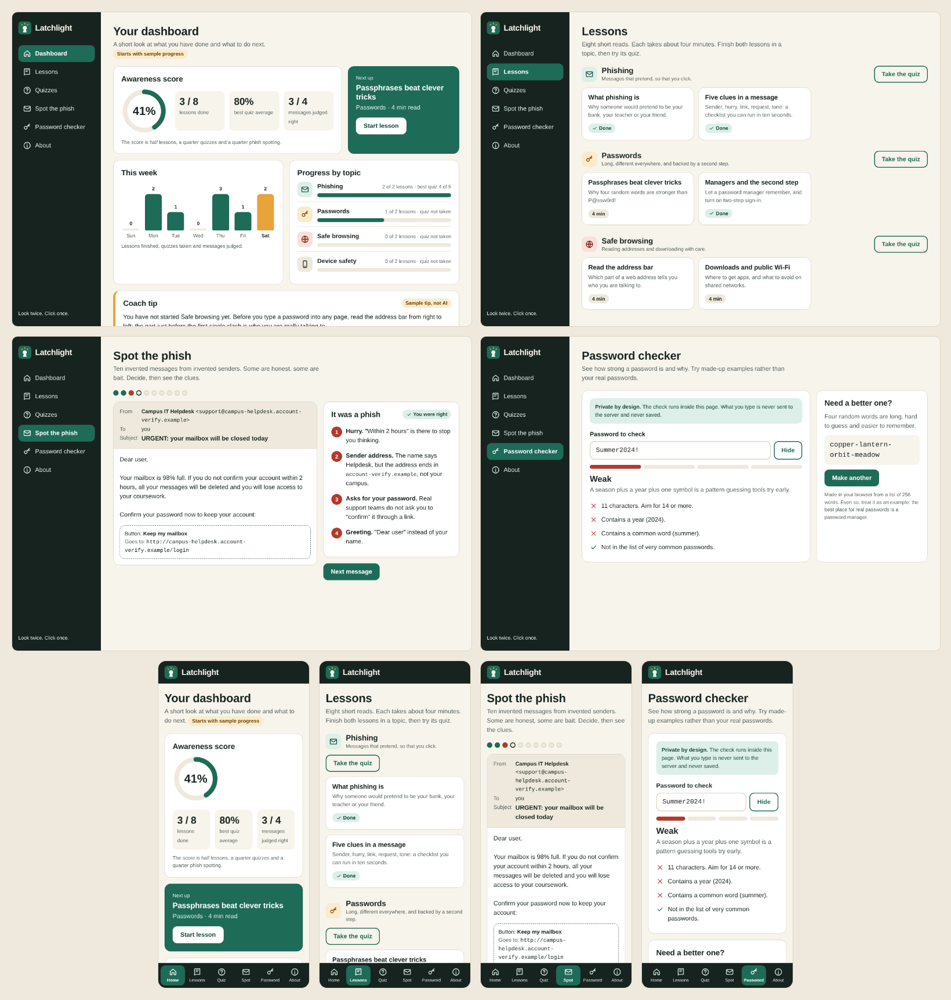
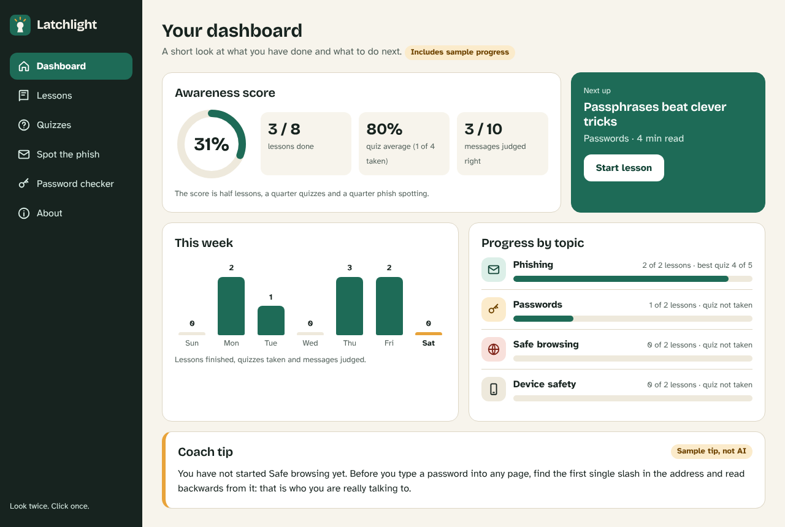
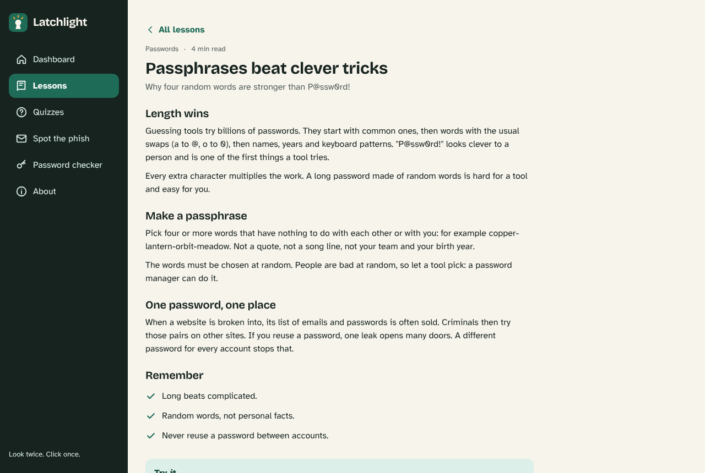
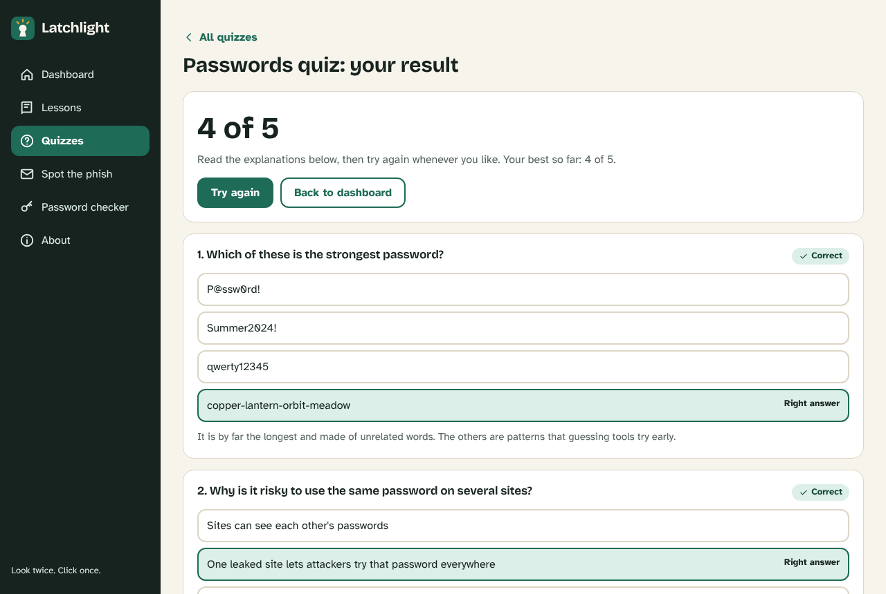
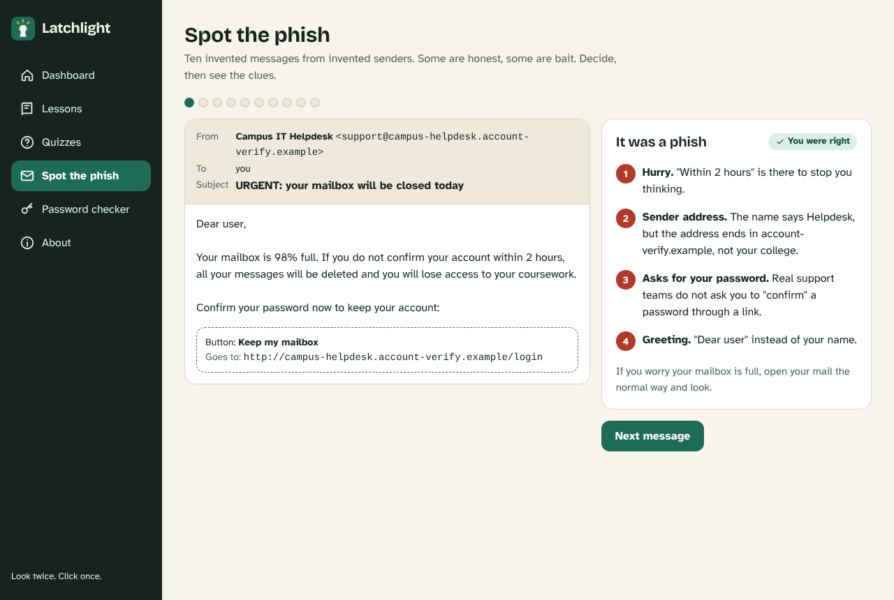
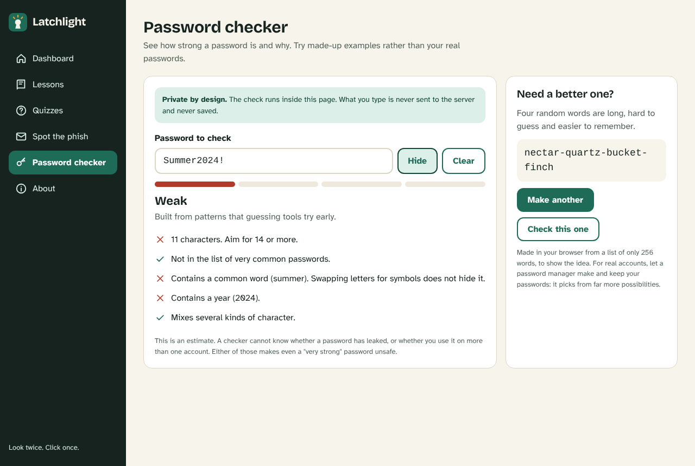
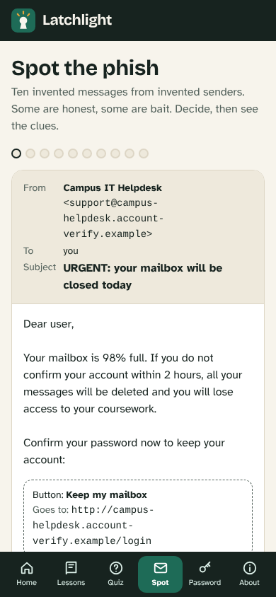

# Portfolio write-up: Latchlight

A draft for a university portfolio. Lines marked **[owner]** need your own words. Do not submit this without reading and editing it: it must be true of what *you* did.

## Summary

**Latchlight** is a web app that teaches everyday online safety to students and small teams. It has short lessons, quizzes that explain every answer, a "spot the phish" exercise built from invented messages, a password checker that never sends the password anywhere, and a dashboard that shows progress.

- Type: full-stack web application (frontend, backend, database)
- Stack: React, Vite, Node.js, Express, SQLite, plain CSS
- Status: working first version with sample content. The dashboard's coach tip is rule-based sample logic; real AI is planned, not built.
- Scope: defensive and educational only. No attack tooling, no real messages sent, no real brands imitated.

## The problem

Most break-ins start with a person, not a machine: a convincing message, a reused password, an update that was put off. Security training exists for large companies, but students and small clubs usually get nothing, or a long slideshow.

**[owner]** Add one or two sentences on why you chose this problem. Have you or someone you know received a fake message?

## Goals

1. Teach four basics in under an hour: phishing, passwords, safe browsing, device safety.
2. Let people practise judging messages safely, with clear feedback on the clues.
3. Show how strong a password is without ever collecting it.
4. Run on a student laptop with free tools and no accounts.
5. Be honest in the interface about what is sample and what is an estimate.

## Design process

1. **Reference.** I started from a reference image of a security training dashboard, for general direction only, and listed what to keep (a side menu, simple charts, training cards) and what must be original (name, colours, type, logo, pictures, wording).
2. **Brand.** The name "Latchlight", a pine green and warm paper palette with a marigold accent, and a keyhole mark with three rays. Body text uses a font designed so that similar characters are easy to tell apart, which suits an app that asks people to read web addresses carefully. All text colours were checked for WCAG AA contrast.
3. **Flows.** Four user flows were written before any screen was drawn (design/UX.md).
4. **Mockups.** Four static HTML mockups using the real stylesheet, at laptop and phone width, so the built app matches them.

A design decision I would point to: the reference shows a manager's view, with a list of staff who are overdue. Latchlight is for the learner. There is no list of people and nothing to be ashamed of. A wrong answer shows the clues you missed.

## How it works

Three layers: React screens ask an Express server for data as JSON; the server reads and writes a SQLite database with eight tables.

Three points of engineering interest:

- **The server keeps the answers.** Quiz answers and phish verdicts are not sent to the browser until the learner has answered. The server does the marking.
- **Privacy by design.** The password checker runs entirely in the browser. The screen has no connection to the server code, the server has no address that accepts a password, and automated tests prove that typing a password causes no network request and leaves nothing in browser storage.
- **A replaceable "smart" part.** The coach tip is one function, `getCoachTip()`, with a fixed input and output, so a real AI model can be plugged in later without changing the screens. Until then it is labelled "Sample tip, not AI".

Full detail: TECHNICAL.md.

## Screens

| Dashboard | Lesson | Quiz result |
|---|---|---|
|  |  |  |

| Spot the phish | Password checker | Phone layout |
|---|---|---|
|  |  |  |

## Testing

- 53 automated backend tests: every API address, bad input, the score sums, the sample coach, the shape of the content (including that every address in a practice message ends in `.example`), and the password checker.
- 27 automated browser tests that use the built app at laptop and phone size, including the privacy check on the password screen.
- Two deliberate bugs were introduced to confirm that the tests catch mistakes.

All passed on 14 Nov 2026. Not tested: Windows, macOS, real phones, Safari and Firefox, screen readers, and the accuracy of the lesson content. Full record: TEST_RESULTS.md.

## Challenges and what I learned

- **Proving privacy instead of promising it.** Saying "we do not store your password" is easy. The project records every network request in a test and fails if a typed password ever appears.
- **A realistic exercise that is still safe.** Practice messages need to look convincing without copying a real company or containing a working link. Invented names, `.example` addresses and links shown as plain text solved this.
- **An accessibility bug found by testing.** On a phone the menu links had no name for screen readers. A click-through script failed to find a link by name, which exposed it. It is fixed and now has a test.
- **Being honest about limits.** The password checker gives an estimate and says so. The four-word passphrase maker uses a short word list and says so.

**[owner]** Add what you personally found hardest and what you learned.

## Limits and next steps

Sample content only, not reviewed by a security professional. One learner, no login, English only, not deployed. Next: content review by a lecturer, more lessons and messages, real AI behind `getCoachTip()`, Arabic with right-to-left layout, then a small-team mode with a teacher view. See PLAN.md.

## Ethics and safety

- **Defensive only.** The app teaches recognition and good habits. It cannot send messages, and it contains no attack tools or instructions for attacking.
- **No real targets.** Every sender and organisation is invented. Addresses use the reserved `.example` ending, and an automated test enforces it.
- **No personal data.** No accounts. Progress stays in one file on the user's own computer. Passwords typed into the checker never leave the page.
- **Honest labels.** Sample progress, sample tips and estimates are marked as such.
- All content is original. Fonts and libraries are open source and credited.

## Suggested wording about AI assistance

"This project was built with the help of an AI coding assistant (Claude). I set the brief and the direction, and asked the assistant to make the decisions listed in PLAN.md on my behalf. The assistant produced the first version of the design, code, lesson content, tests and documents. I then **[owner: say what you did, for example reviewed the code, ran it, changed X, added Y]**."

Only claim what is true. Check your university's rules on AI assistance before you submit. The best way to make this project yours is to do the exercises in LEARNING_NOTES.md part 12 and describe them here.
