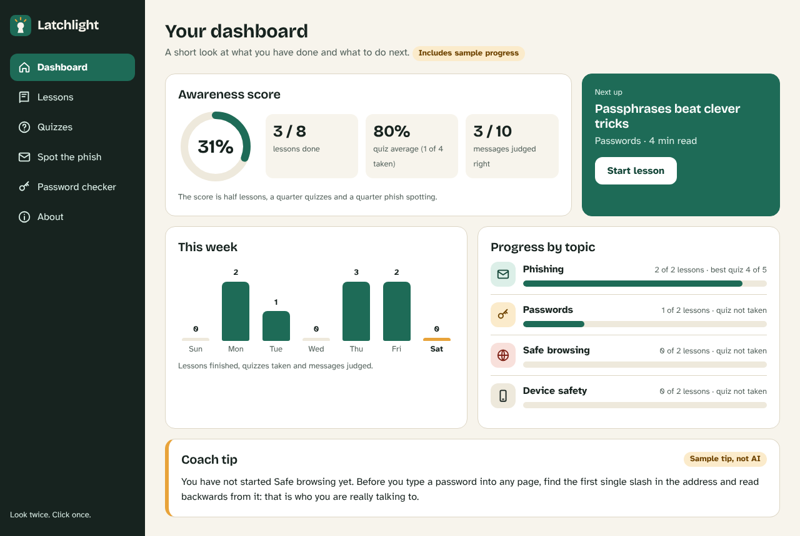
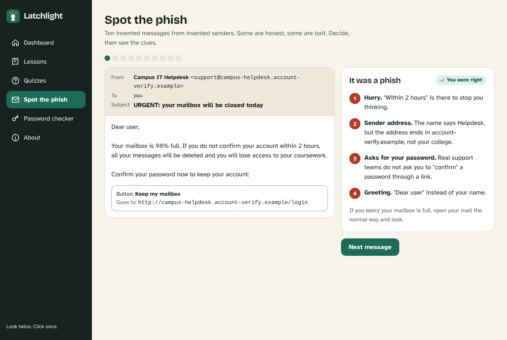

# Latchlight (Cybersecurity Awareness Tool)

**Look twice. Click once.** A small trainer for everyday online safety: short lessons, quizzes, a "spot the phish" exercise, a password checker and a progress dashboard.

University portfolio project. Honest status of every part: [STATUS.md](STATUS.md).





> **Defence only.** The app teaches people to protect themselves. It sends no messages and contains no attack tools. Every sender and organisation in the practice messages is invented, with addresses ending in `.example`.
>
> The coach tip is **not AI**. It is picked by simple rules and labelled as a sample.

## What you can do in it

- Read 8 short lessons in 4 topics: phishing, passwords, safe browsing, device safety
- Take a 5-question quiz for each topic. The server marks it and explains every answer.
- Practise on 10 invented messages: decide **Phish** or **Looks safe**, then see the clues
- Check how strong a password is. This runs only in your browser. The password is never sent and never saved.
- Make a random four-word passphrase
- See your awareness score, your week and your progress by topic on the dashboard

The app starts with a little sample progress so the dashboard is not empty. **About, then Start fresh** removes it.

## How to run it

You need one free thing: **Node.js version 22.13 or newer** (download the "LTS" version from nodejs.org). No accounts, no keys, no payment.

Open a terminal in the `app` folder, then:

```
npm install
npm run build
npm start
```

Now open **http://localhost:3311** in your browser. To see the phone layout on a computer, make the window narrow.

To stop it, press `Ctrl + C` in the terminal.

### While changing the code

```
npm run dev
```

Then open **http://localhost:5311**. The page refreshes by itself when you save a file.

### Run the tests

```
npm test             backend tests (53)
npm run test:e2e     browser tests (27). Needs "npm run build" first, and Playwright:
                     npm install -D playwright && npx playwright install chromium
```

### Start again with the sample data

Stop the app and delete the file `app/data/latchlight.db`. It is rebuilt with the lessons and the sample progress the next time you start.

### One-page preview

`npm run build:preview` makes `app/preview/latchlight-preview.html`: the same screens in a single file that needs no server. Progress in the preview is kept in memory and resets when the page is reloaded.

## Where things are

| File or folder | What it is |
|---|---|
| [PLAN.md](PLAN.md) | Roadmap, tech choices and the list of decisions you can change |
| [BRAND.md](BRAND.md), `brand/` | Name, colours, fonts, logo |
| [design/UX.md](design/UX.md), `design/mockups/` | Screens, user flows, HTML mockups |
| `app/client/` | The screens (React) |
| `app/server/` | The server and database (Express + SQLite) |
| `app/shared/password.js` | **The password checker.** Used only by the browser. |
| `app/server/coach.js` | **The coach tip function.** Sample logic for now, the place for real AI later. |
| `app/server/seed-data.js` | All lessons, questions and practice messages. Edit this to change them. |
| [TEST_RESULTS.md](TEST_RESULTS.md) | What was tested, what passed, what was not tested |
| [TECHNICAL.md](TECHNICAL.md) | How it is built |
| [LEARNING_NOTES.md](LEARNING_NOTES.md) | The key ideas and code explained for a beginner |
| [PORTFOLIO.md](PORTFOLIO.md) | The write-up for a university portfolio |
| `reference-style.png` | Someone else's design, used for direction only. Not part of the product. |

## Known limits

- Tested on Linux with Chromium only. Not yet tried on Windows, macOS, Safari, Firefox or a real phone.
- One learner, one computer. No login. Not on the internet.
- The lessons are general good practice written with an AI assistant. They have not been reviewed by a security professional.
- The password checker gives an estimate. It cannot know whether a password has leaked or is reused.
- English only.

## Credits

Design, code, lesson text, logo and icons were made for this project with Claude (AI assistant), directed by the owner. Fonts: Bricolage Grotesque and Atkinson Hyperlegible (SIL Open Font Licence). Libraries: React, React Router, Vite, Express (all MIT licence).
