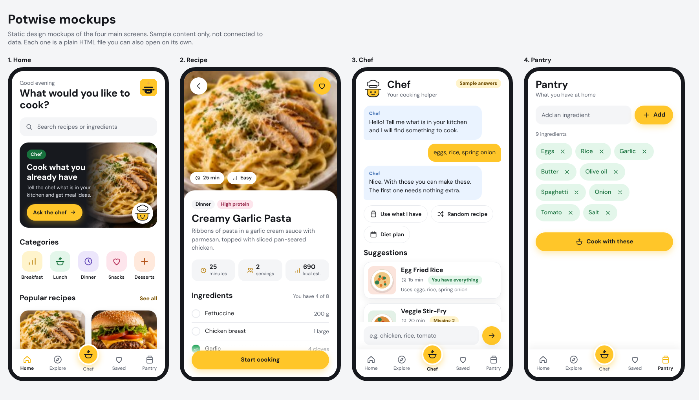
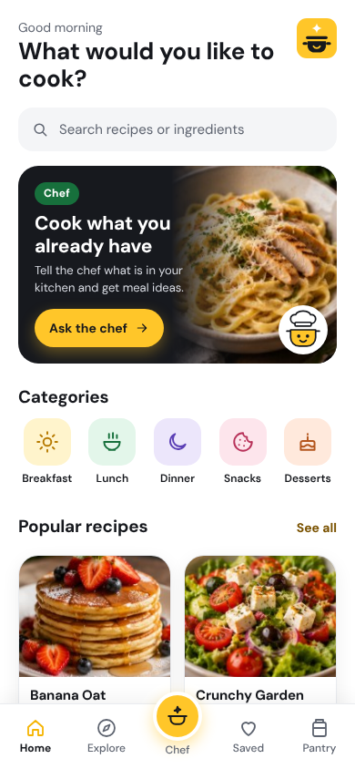
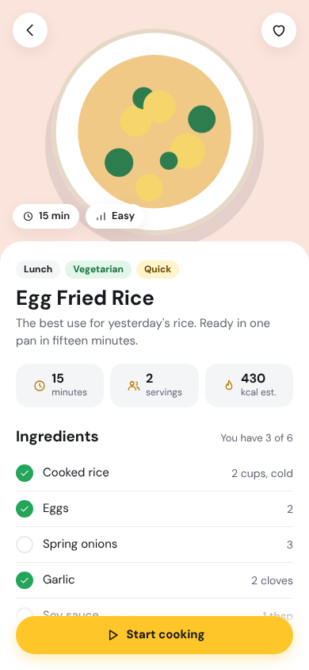
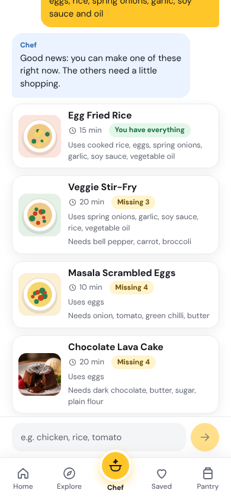
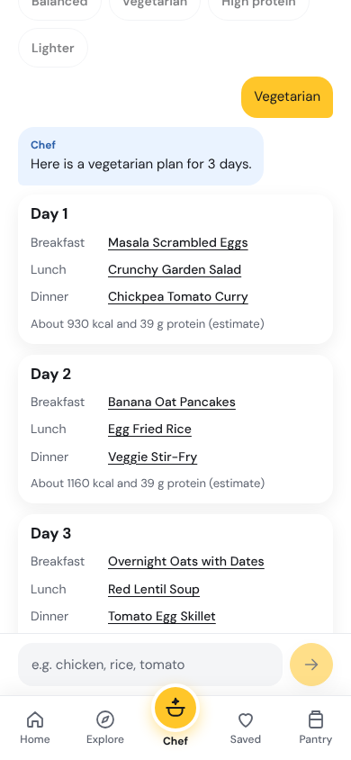

# Portfolio write-up: Potwise

A draft for a university portfolio. Written in the first person so you can edit it into your own words. Lines marked **[owner]** need your own input: do not submit them as they are.

> Honesty note for the owner: this version was designed and coded by Claude (an AI assistant) under your instructions. Check your university's rules on AI assistance and say clearly what you did yourself. A suggested wording is at the end.

## Summary

**Potwise** is a mobile-first web app that helps people cook with what they already have. You keep a list of the ingredients in your kitchen, and a chef helper suggests recipes, showing what each one uses and what is missing. It also offers a random recipe and a simple three-day meal plan.

- Type: full-stack web application (frontend, backend, database)
- Stack: React, Vite, Node.js, Express, SQLite, plain CSS
- Status: working first version with sample data and a rule-based sample chef. Real AI is planned, not built.

## The problem

People often have food at home and still do not know what to cook. Recipe apps usually start from the recipe and send you shopping. Potwise starts from your kitchen.

**[owner]** Add one or two sentences on why you chose this problem.

## Goals

1. Suggest meals from a list of ingredients, best match first.
2. Make a recipe easy to follow on a phone with one hand.
3. Run on a student laptop with free tools and no accounts.
4. Be honest in the interface about what is sample and what is estimated.

## Design process

1. **Reference.** I started from a reference image of a recipe app for general direction only, and listed what to keep (a chef helper, quick actions) and what must be original (name, colours, type, logo, pictures).
2. **Brand.** Name "Potwise" and a pot-and-spark logo mark. The first look was paprika and cream with serif headings. After seeing it in use, I moved it closer to my reference: white and warm yellow, one rounded sans-serif font, food photos, and a friendly pot mascot. All text colours were checked for WCAG AA contrast.
3. **Flows.** Five user flows were written before any screen was drawn (design/UX.md). The main one is Pantry, then Chef, then Recipe.
4. **Mockups.** Four static HTML mockups using the real stylesheet, so the built app matches them.

A second decision: the redesign. Food apps sell with food, so the yellow look with photos made the app feel much more inviting than drawn plates. The checks still mattered: two colour pairs in the new look failed contrast and were fixed.

A design decision I would point to: adding a **Pantry** tab. "Use what I have" is meaningless unless the app knows what you have, so the pantry became a main screen rather than a setting.

## How it works

Three layers: React screens ask an Express server for data as JSON; the server reads and writes a SQLite database. The database has five tables; recipes have a one-to-many relationship with ingredients and steps.

The chef is a single function, `suggestMeals()`. It normalises ingredient names ("2 Tomatoes" and "Chopped tomatoes" both become "tomato"), then ranks recipes by fewest missing ingredients. It is written as a replaceable part with a fixed input and output, so a real AI model can be plugged in later without changing the screens.

Full detail: TECHNICAL.md.

## Screens

| Home | Recipe | Chef | Diet plan |
|---|---|---|---|
|  |  |  |  |

## Testing

- 47 automated backend tests (ingredient matching, chef logic, every API address, bad input, an SQL injection attempt).
- 21 automated browser tests that use the built app at phone size.
- A deliberate bug was introduced to confirm the tests catch mistakes.

All passed on 14 Nov 2026. Not tested: Windows, real phones, Safari and Firefox, screen readers. Full record: TEST_RESULTS.md.

## Challenges and what I learned

- **Matching human words.** The same ingredient is written many ways. A small normalising function plus a test that checks all sample data against it solved this simply. Its limits are documented.
- **Keeping chat while moving between screens.** The chat was lost when leaving the Chef screen. Moving its state up to the top component fixed it.
- **Being honest about AI.** It would be easy to call rule-based matching "AI". The interface labels it "Sample answers" and the status file separates working from planned.

**[owner]** Add what you personally found hardest and what you learned.

## Limits and next steps

21 sample recipes (8 with photos), one user, no login, English only, not deployed. Next: real AI behind `suggestMeals()`, adding your own recipes, a shopping list for missing ingredients, Arabic and right-to-left layout, then an installable phone version. See PLAN.md.

## Ethics and safety

- No personal data is collected. Everything stays on the user's computer.
- Nutrition numbers are labelled as estimates, and the meal plan states it is not dietary or medical advice.
- Recipes, text, logo and code are original. The 8 food photos were made by me with an AI image tool **[owner: name the tool]**; they are not photos of real dishes. No other brands. Fonts and libraries are open source and credited.

## Suggested wording about AI assistance

"This project was built with the help of an AI coding assistant (Claude). I set the brief, chose the direction and made the decisions listed in PLAN.md. The assistant produced the first version of the design, code, tests and documents. I then **[owner: say what you did, for example reviewed the code, ran it, changed X, added Y]**."

Only claim what is true. The best way to make this project yours is to do the exercises in LEARNING_NOTES.md part 10 and describe them here.
