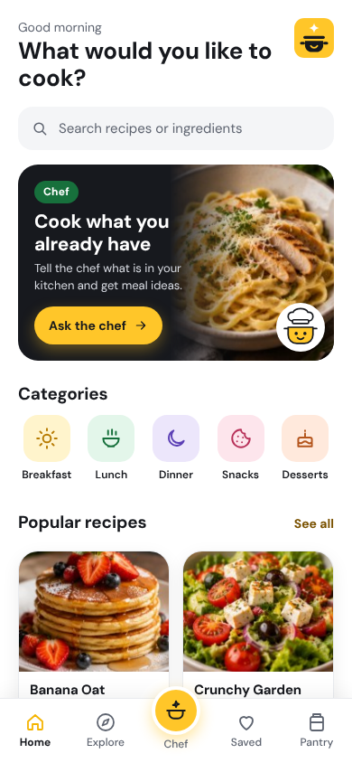
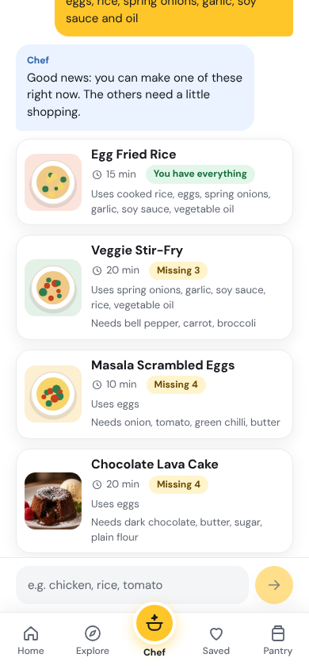

# Potwise (Pantry Chef AI)

**Cook what you already have.** A phone-style recipe app with a chef helper that suggests meals from the ingredients in your kitchen.

University portfolio project. Honest status of every part: [STATUS.md](STATUS.md).

 

> The chef is **not real AI yet**. It gives sample suggestions by matching your ingredients to 16 sample recipes. The app labels this clearly.

## What you can do in it

- Browse and search 16 sample recipes, filter by category
- Open a recipe: time, level, servings, estimated calories, ingredients (ticked if you have them), steps you can tick off
- Keep a pantry list of what you have at home
- Ask the chef: type ingredients, or tap **Use what I have**, **Random recipe** or **Diet plan**
- Save recipes with the heart

## How to run it

You need one free thing: **Node.js version 22.13 or newer** (download the "LTS" version from nodejs.org). No accounts, no keys, no payment.

Open a terminal in the `app` folder, then:

```
npm install
npm run build
npm start
```

Now open **http://localhost:3001** in your browser. To see it phone-sized on a computer, make the window narrow, or press F12 and pick the phone icon.

To stop it, press `Ctrl + C` in the terminal.

### While changing the code

```
npm run dev
```

Then open **http://localhost:5173**. The page refreshes by itself when you save a file.

### Run the tests

```
npm test             backend tests (47)
npm run test:e2e     browser tests (21). Needs "npm run build" first, and Playwright:
                     npm install -D playwright && npx playwright install chromium
```

### Start again with fresh data

Stop the app and delete the file `app/data/potwise.db`. It is rebuilt with the sample recipes and the starter pantry the next time you start.

## Where things are

| File or folder | What it is |
|---|---|
| [PLAN.md](PLAN.md) | Roadmap, tech choices and the list of decisions you can change |
| [BRAND.md](BRAND.md), `brand/` | Name, colours, fonts, logo |
| [design/UX.md](design/UX.md), `design/mockups/` | Screens, user flows, HTML mockups |
| `app/client/` | The screens (React) |
| `app/server/` | The server and database (Express + SQLite) |
| `app/server/chef.js` | **The AI chef function.** Sample logic for now. |
| `app/server/seed-data.js` | The 16 sample recipes. Edit this to change them. |
| [TEST_RESULTS.md](TEST_RESULTS.md) | What was tested, what passed, what was not tested |
| [TECHNICAL.md](TECHNICAL.md) | How it is built |
| [LEARNING_NOTES.md](LEARNING_NOTES.md) | The key ideas and code explained for a beginner |
| [PORTFOLIO.md](PORTFOLIO.md) | The write-up for a university portfolio |
| `reference-style.png` | Someone else's design, used for direction only. Not part of the product. |

## Known limits

- Tested on Linux with Chromium only. Not yet tried on Windows, macOS, Safari, Firefox or a real phone.
- One person, one computer. No login. Not on the internet.
- Sample recipes and estimated nutrition numbers. Not dietary advice.
- English only.

## Credits

Design, code, recipes text, logo and illustrations were made for this project with Claude (AI assistant), directed by the owner. Fonts: Fraunces and DM Sans (SIL Open Font Licence). Libraries: React, React Router, Vite, Express (all MIT licence).
